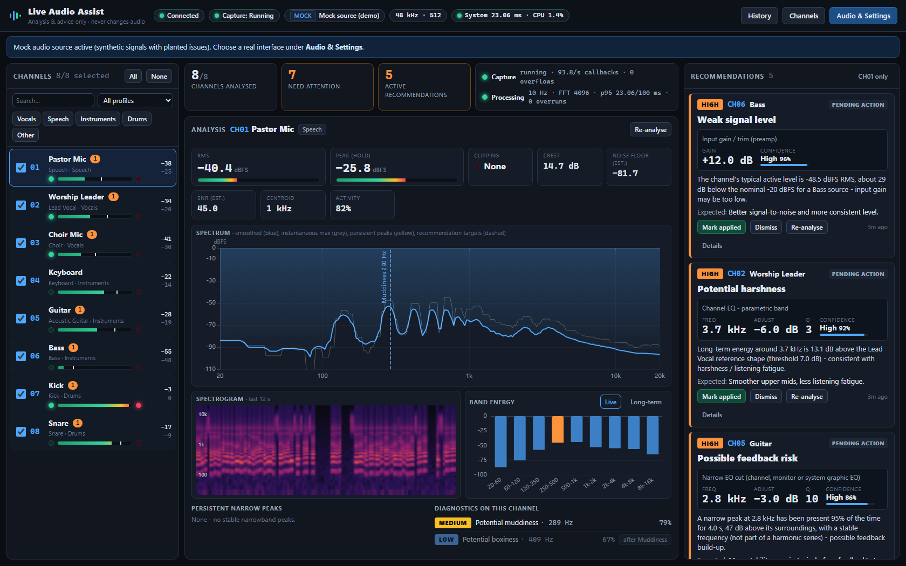

# Live Audio Assist

A local-first assistant for live sound engineers. It continuously analyses the input
channels you select, detects likely problems (muddiness, harshness, feedback risk, hum,
rumble, clipping, …) and tells the operator **what to adjust, where, by how much, why,
and how confident it is** — then checks whether the problem is gone after the operator
acts.

> **It never changes audio.** No EQ, gain, routing, dynamics or mixer parameter is ever
> modified. Every recommendation is advice; the operator decides. "Mark applied" only
> records that *you* made an adjustment so the analyser can verify it.

## Quick start

| | macOS | Windows 11 |
|---|---|---|
| 1. Setup (once) | `./setup.sh` | `.\setup.ps1` |
| 2. Start | `./start.sh` | `.\start.ps1` |

Requirements: **Python 3.12+** and **Node.js LTS** (only needed to build the dashboard).
The dashboard opens automatically at <http://localhost:8765>. Stop with **Ctrl+C**.
On first start the system default input is used; pick your interface under
**Audio & Settings**. Details: [INSTALL_WINDOWS](docs/INSTALL_WINDOWS.md) ·
[INSTALL_MACOS](docs/INSTALL_MACOS.md).

On Windows, if script execution is blocked: `powershell -ExecutionPolicy Bypass -File .\setup.ps1`.

## What it does

- **Device management** – lists input devices with host API (WASAPI, MME, DirectSound,
  WDM-KS, ASIO if present / Core Audio), channel counts, probed sample rates, latency;
  select device, sample rate (44.1/48/88.2/96 kHz), buffer size, channel count; one-second
  device test; start/stop/restart capture at runtime; disconnect detection and automatic
  recovery.
- **Multichannel capture** – PortAudio callback copies blocks into a bounded ring buffer and
  nothing else. Analysis runs on its own thread; overflows, stalls and lost frames are counted.
- **Channel selection** – select individually, all, none, or by group (Shift = add group);
  search; profile filter. Only selected channels are analysed and can produce
  diagnostics. Names, profiles, groups and enable flags are editable and persisted.
- **12 channel profiles** – Speech, Lead/Backing Vocal, Choir, Acoustic/Electric Guitar,
  Bass, Keyboard, Kick, Snare, Cymbals, General. Profiles give context (expected tonal
  balance, relevant issues, tolerances, HPF range); they do not impose EQ presets.
- **DSP** – windowed FFT (2048/4096/8192), Parseval-scaled PSD, 1/6- and 1/3-octave smoothing,
  9 analytical bands, centroid/roll-off/flatness, RMS/peak/crest/clipping, adaptive noise
  floor, SNR *estimate* (only when quiet and active periods are distinguishable), hum
  detection, narrowband peak tracking (persistence, Q, frequency stability, level trend,
  harmonic-series membership), spectrogram.
- **Deterministic diagnostics** – 16 explainable rules with persistence windows, hysteresis,
  conflict suppression (e.g. hum explains "boominess"; feedback outranks harshness), cooldowns and
  an explicit confidence formula. See [DIAGNOSTIC_RULES](docs/DIAGNOSTIC_RULES.md).
- **Recommendations** – mixer control, filter type, frequency, gain, Q, HPF corner, gain
  change, steps, expected improvement, caveats and the supporting evidence. Lifecycle
  New → Pending → Applied → Resolved, or Dismissed / Expired, with before/after comparison.
- **Dashboard** – dark, large-type Angular UI: channel strip with live meters, spectrum with
  peaks and recommendation markers, spectrogram, band energy, ranked recommendation cards,
  overall/health status, history, settings.
- **Storage** – SQLite: settings, device configs, channels, diagnostic & recommendation
  history, operator actions. No audio is recorded.

## Documentation

| | |
|---|---|
| [ARCHITECTURE](docs/ARCHITECTURE.md) | modules, threads, data flow |
| [AUDIO_SETUP](docs/AUDIO_SETUP.md) | interfaces, channel mapping, host APIs, sample rates |
| [DSP_DESIGN](docs/DSP_DESIGN.md) | scaling, smoothing, interpreting the spectrum |
| [DIAGNOSTIC_RULES](docs/DIAGNOSTIC_RULES.md) | every rule, threshold, confidence and recommendation logic |
| [API](docs/API.md) | REST + WebSocket reference (interactive docs at `/docs`) |
| [DEVELOPMENT](docs/DEVELOPMENT.md) | dev workflow, tests, calibration harness |
| [TROUBLESHOOTING](docs/TROUBLESHOOTING.md) | common problems |

## Validation status

- **Validated on Windows 11 Pro (x64, Intel i7-13700H)**: Python 3.13.17, Node 26.13, Angular 22.3, ECharts 6.1.
  Backend tests (105) and frontend tests (15) pass; setup/start scripts executed; real capture
  validated through WASAPI, MME and DirectSound (built-in microphone array) with zero
  overflows.
- **macOS: not yet validated on hardware.** The code and `setup.sh`/`start.sh` are written to
  be portable (Core Audio via PortAudio; scripts pass `bash -n`), but have not been run on a Mac.
- No professional multichannel interface (>4 inputs) or ASIO driver was available for testing.

## Limitations (honest summary)

- An FFT-based analyser cannot hear like an engineer. Diagnoses are *likely* issues based on
  spectral shape relative to a generic profile reference; rooms, sources and styles differ.
  Thresholds are conservative starting points and were calibrated on synthetic signals, not
  on a large corpus of real recordings.
- Feedback-risk detection needs a ring to persist for ~2–3 s; it is a warning aid, not a
  feedback suppressor. Keyboard/bass/kick/snare/cymbal profiles do not assess feedback.
- SNR is an estimate from the level distribution (no calibrated noise reference).
- Hum detection at FFT 2048 cannot reliably separate 50 from 60 Hz; use 4096+.
- Analysis cost is ~2 ms per channel per tick on the test machine; very high channel
  counts may need a lower analysis rate (see [TROUBLESHOOTING](docs/TROUBLESHOOTING.md)).
